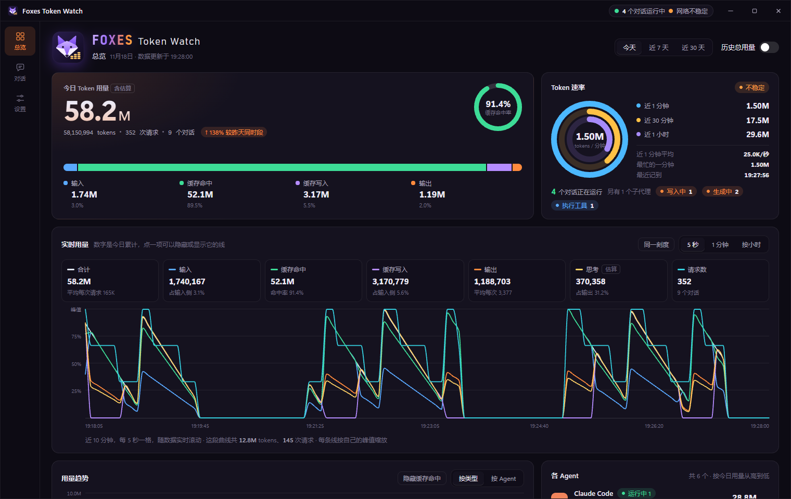
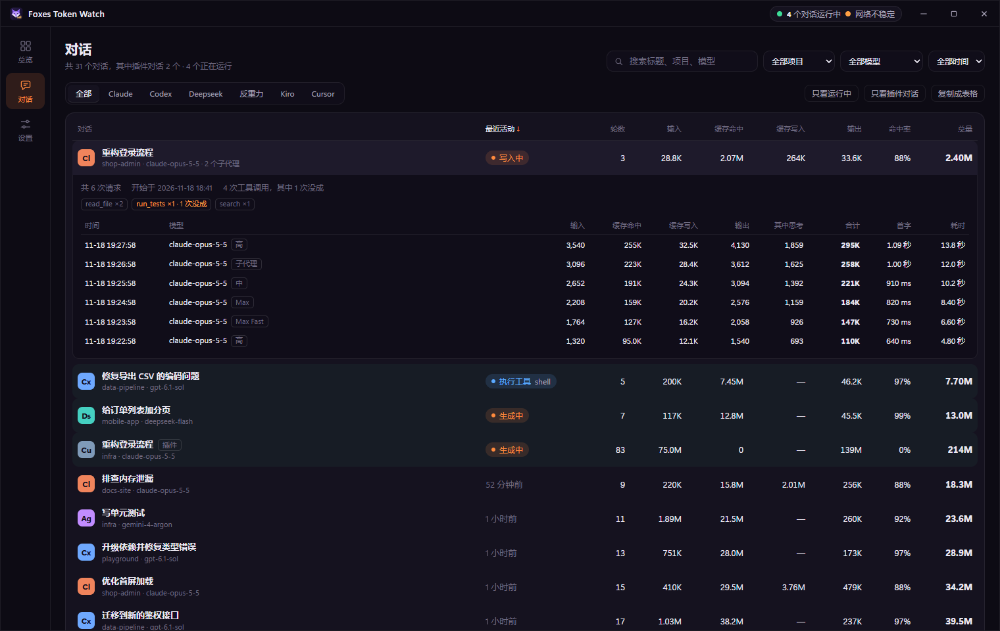
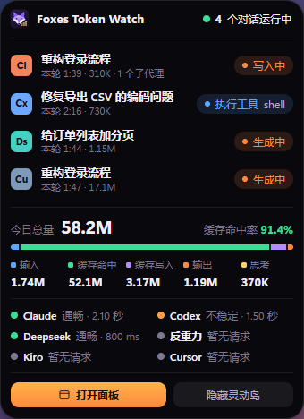

# Foxes Token Watch

**Windows 本地 AI Agent 用量与会话状态监控 · v0.5.1**

在同一个面板查看不同 AI 编程助手用了多少 Token、哪些会话正在运行，以及一次请求的缓存命中和耗时。不打开主窗口时，也可以用桌面灵动岛和系统托盘随时看状态。

[版本发布](https://github.com/Foxes-viola/Foxes-Token-Watch/releases) · [更新日志](CHANGELOG.md) · [问题反馈](https://github.com/Foxes-viola/Foxes-Token-Watch/issues) · [许可](LICENSE)

## 界面预览

以下截图来自 v0.5.1 的实际前端，使用内置模拟数据，不包含真实会话、路径或用量历史。

### 总览：看清用量去哪了



切换今日、近 7 天、近 30 天或全部记录；按 Token 类型或按 Agent 查看趋势，也可以隐藏缓存命中量，对比实际输入与输出。面板还提供模型、项目和活动分布，便于定位用量变化。

### 对话：展开查看每次请求



按 Agent、项目、模型、时间等条件筛选，点击表头排序，点击一条对话展开明细。来源提供相应字段时，可查看输入、缓存读写、输出、思考量、首字延迟、总耗时，以及使用过的工具与结果计数。子代理的请求也可以纳入统计。排序、筛选和总览视图会记住上次选择。

### 灵动岛：不用打开主面板



收起时显示当日用量和状态指示，悬停展开后可查看运行中的会话。支持拖动、边缘停靠、托盘常驻、可选开机自启与完成提醒。可选深色、浅色或跟随系统主题，并可以减少动效。

## 支持哪些来源？

- **Claude Code、Codex、Deepseek Harness、Antigravity、Kiro、Cursor**：从各自可用的本机记录提取用量和状态。
- **Cursor 网关 / 网页 MCP、百事通**：属于实验适配。不同插件或版本的记录格式可能导致漏记、重复识别或延迟；不保证开箱即用。
- 来源未提供准确 Token 数时，界面会标注估算。不同来源的字段完整度不一，**统计不等同于服务商的账单或剩余额度**。

## v0.5.1 有什么变化？

- 便携程序从约 **13.0 MB** 减至 **9.6 MB**，安装包从约 **3.4 MB** 减至 **2.9 MB**；保留原功能和用量历史格式。这是本版 Windows 构建记录中的体积，不是本次源码下载的大小。
- 修复长工具名挤进「轮数」列的问题。保留 v0.5.0 引入的请求明细、主题跟随系统、减少动效及会话筛选。
- 统计线程发生意外中断时可自动恢复；界面不展开时降低汇总频率；历史写盘更少，并保留最近七天的每日备份。详见 [更新日志](CHANGELOG.md)。

## 本地数据与隐私

- 程序只读访问 Agent 的来源记录，不修改原始日志，也不将对话正文保存到用量历史。面板及诊断信息仍可能显示会话标题、项目路径、模型和工具名；分享截图或问题日志前请先脱敏。
- 统计在本机完成，不向作者上传数据。百事通适配会向 `127.0.0.1:9791` 的本机服务发送 GET 请求；如需补装 WebView2，安装器可能从微软下载运行时，这与用量统计无关。
- 设置和 `history.json` 位于应用数据目录；实际位置见 **设置 → 关于**。历史备份位于 `history-backup/`。便携版可在程序旁边的 `Foxes-watch-data/` 保留一份历史；公开发布时请勿打包这个目录。

## 从源码运行与构建

目标平台为 **Windows 10/11 x64**。准备 Node.js 24、Rust 稳定版 MSVC 工具链、包含 Windows SDK 的 Visual Studio C++ Build Tools，以及 Microsoft Edge WebView2。

```powershell
npm ci
npm run dev                 # 浏览器预览，仅使用模拟数据
npm run tauri -- dev        # 运行桌面程序，读取本机数据
npm run build               # 类型检查并构建前端
cargo test --locked -p foxes-core --lib
```

制作 Windows 安装包与便携程序：

```powershell
npm run package:windows
```

安装包输出到 `installers/`，便携程序输出为根目录的 `Foxes-watch.exe`。打包结束默认清理可重建的开发依赖和缓存；如需保留，可运行 `npm run package:windows -- -KeepBuildFiles`。

## 源码结构

- `crates/foxes-core/`：Rust 读取器、用量汇总、估算和历史存储。
- `src-tauri/`：Tauri 桌面外壳、窗口、托盘、灵动岛和设置持久化。
- `src/`：React + TypeScript 界面；`src/lib/mock.ts` 提供浏览器演示数据。
- `scripts/`：Windows 打包与构建清理脚本。

## 反馈与许可

反馈问题时建议提供软件版本、Windows 版本、涉及的 Agent 和复现步骤，请勿附上完整应用数据目录或原始会话日志。

作者：**Foxes**。沿用 **PolyForm Noncommercial 1.0.0**；详细条款见 [LICENSE](LICENSE) 和 [NOTICE](NOTICE)，第三方依赖适用各自的[许可证](THIRD_PARTY_NOTICES.txt)。非商业范围以许可正文为准；商用须另行取得授权。
